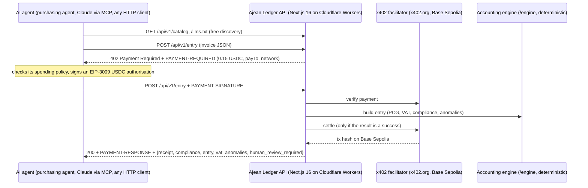

# Ajean Ledger

> An API that lets any AI agent send a French invoice or bank transaction and get back a validated,
> machine-readable accounting entry (PCG accounts, VAT treatment, e-invoicing compliance, anomaly flags).
> The agent pays per call in USDC through the x402 HTTP payment protocol. No sign-up, no API key:
> **payment is the authentication.**

**Public demo:** <https://ajean-ledger.ary-sidoun.workers.dev> ·
[`/live`](https://ajean-ledger.ary-sidoun.workers.dev/live) (live agent console) ·
[`/operator`](https://ajean-ledger.ary-sidoun.workers.dev/operator) (the agent economy, seen by the operator) ·
[`/llms.txt`](https://ajean-ledger.ary-sidoun.workers.dev/llms.txt)

Proof of concept for the course *Digital Transformation & FinTech — The AI Agent Economy Challenge*.
**Testnet only** (Base Sepolia test USDC) · **synthetic data only** (fictional companies, unallocated `000…` SIRENs) ·
**not a substitute for a chartered accountant's review**.

## Quickstart (3 commands)

Node ≥ 20. No `.env` needed: without one, payments run in **SIMULATED** mode (same x402 wire format, local facilitator, fake tx hash).

```bash
git clone https://github.com/ArySid/ajean-ledger.git && cd ajean-ledger && npm ci
npm test          # 200+ tests: 13 accounting fixtures, x402 paid API, discovery, MCP, demo agent, console
npm run dev       # http://localhost:3000 — open /live and click "Run scenario"
```

### Try it as an agent (second terminal)

```bash
curl -i -X POST localhost:3000/api/v1/entry -H 'content-type: application/json' -d '{}'
#   → HTTP 402 + PAYMENT-REQUIRED header (base64 JSON: 0.15 USDC = "150000", payTo, asset, network eip155:84532)
npm run agent           # the SME purchasing agent processes inbox/: discovers, checks its budget, pays, books, flags
npm run pay:simulated   # the raw x402 flow: 402 → signed EIP-3009 payment → 200 + receipt, idempotent replay
npm run -s engine -- fixtures/03.json   # the engine alone: restaurant billed at 20% instead of 10%
```

No `AGENT_PRIVATE_KEY`? In SIMULATED mode the scripts generate an **ephemeral** in-memory wallet and say so.
Real testnet payments: `npx tsx scripts/gen-wallets.ts` (throwaway wallets into `.env.local`), fund the agent with
test USDC at <https://faucet.circle.com> (Base Sepolia), then `PAYMENT_MODE=testnet npm run dev` and `npm run pay:testnet`.

## What it is

- **For agents, not humans.** JSON-only API, discovery files (`/api/v1/catalog`, `/openapi.json`, `/llms.txt`,
  `/.well-known/agent.json`), an MCP server (`/mcp` and a stdio bridge), machine-readable error codes,
  idempotency keys and free receipts. The web pages only *observe* agent traffic.
- **Paid per call in USDC** with [x402 v2](https://x402.org) (`@x402/*` 2.31.0): `POST /api/v1/invoice/check`
  0.05 · `POST /api/v1/entry` 0.15 · `POST /api/v1/audit` 1.00 (up to 50 entries). Settled only on success:
  an agent is never charged for a failed call.
- **Rules first, LLM second.** A deterministic TypeScript engine (PCG accounts, VAT 20/10/5.5/2.1 %, reverse charge,
  exemptions, e-invoicing reform mentions, duplicates, fixed assets, credit notes) on JSON, Factur-X and UBL inputs.
  The optional LLM only extracts unstructured documents; ambiguous cases return `human_review_required: true`.
- **The demo story:** an SME's purchasing agent receives a restaurant invoice billed at 20% VAT instead of 10%, pays
  Ajean Ledger 0.15 USDC in one HTTP exchange and gets a balanced entry that deducts only the VAT legally due,
  plus the warning a human would have missed.

## Architecture



```
agent ──POST──▶ 402 (price) ──sign USDC──▶ POST + PAYMENT-SIGNATURE ──▶ x402 facilitator (verify)
                                                                          │
           200 + entry + receipt (tx hash) ◀── settle ◀── Ajean Ledger engine (PCG / VAT / e-invoicing)
```

### Payment modes

| Badge | Set by | What happens |
|---|---|---|
| **TESTNET** | server `PAYMENT_MODE=testnet` | Real x402 payment in test USDC, settled on Base Sepolia by the x402.org facilitator; tx hash links to Basescan. |
| **SIMULATED** | server `PAYMENT_MODE=simulated` (default) | Same 402 → signed payment → 200 exchange and real signature checks; a local facilitator returns a fake `0x5151…` tx hash. Works offline. |
| **REPLAY** | the console | Plays back a trace recorded from a real run (`demo/replays/`). Automatic when a live run fails, so the demo cannot fail. |

### Hosting: Cloudflare Workers, free plan

The public demo runs on Cloudflare Workers (free plan) through the OpenNext adapter, with a free KV namespace for
receipts and operator stats (memory fallback if KV fails). Free-plan limits and their impact: **100,000 requests/day**
(one demo run ≈ 5 requests: ample), **10 ms CPU per request** (JSON paths ≈ 6 ms warm; Factur-X PDF and 50-item
audits can exceed it, so the live demo uses JSON fixtures and any failure falls back to REPLAY), 1,000 KV writes/day
(≈ 250 paid calls). A simple per-IP rate limit (120/min on paid endpoints, 30/min on demo runs) protects the quota.
x402 was created by Coinbase, and Cloudflare co-founded the x402 Foundation with Coinbase (Sept. 2025) and supports
x402 in its Agents SDK and MCP tooling, so hosting an agent-payment service on Cloudflare fits the protocol's ecosystem. Details, measurements and the testnet go-live sequence: [`docs/HOSTING.md`](docs/HOSTING.md).

Day-J check: `npm run warmup` (targets the public URL, ends with **READY FOR DEMO** or **NOT READY**).

## Repo map

| Path | What |
|---|---|
| `engine/` | Accounting engine (pure TypeScript, no framework): rules tables, compliance checks, entry builder, VAT, anomalies, Factur-X / UBL parsers, optional LLM extraction |
| `fixtures/` | 13 synthetic invoices / bank transactions with expected outputs |
| `app/api/v1/` | Paid API (`entry`, `invoice/check`, `audit`) + free `catalog`, `receipts/{id}`, `operator/stats` |
| `app/` (pages) | Demo console: `/` landing, `/live` agent console, `/operator` dashboard, `/office` |
| `lib/payments/`, `lib/api/` | x402 v2 server, pricing (single source), simulated facilitator, receipts, idempotency, rate limit |
| `lib/discovery/`, `app/mcp/`, `mcp/` | Discovery files, remote MCP server, stdio MCP bridge for Claude Desktop |
| `agent/`, `inbox/` | Demo purchasing agent (scripted, optional Claude tool use) and its inbox |
| `demo/replays/` | Recorded agent runs used by REPLAY |
| `scripts/` | CLIs: engine, pay (simulated / testnet), smoke, warmup, record replays, wallets, Cloudflare build |
| `tests/` | Vitest suites (no network) |
| `docs/`, `deliverables/` | Design docs, decisions, prompts; concept note, demo script, slides outline, Q&A prep |

## Docs

- [`docs/ENGINE.md`](docs/ENGINE.md) — accounting rules · [`docs/LEGAL_REVIEW.md`](docs/LEGAL_REVIEW.md) — legal references gate
- [`docs/PAYMENTS.md`](docs/PAYMENTS.md) — x402 flow, headers, errors, idempotency, storage
- [`docs/DISCOVERY.md`](docs/DISCOVERY.md), [`docs/MCP.md`](docs/MCP.md) — agent discovery and MCP
- [`docs/AGENT.md`](docs/AGENT.md) — demo agent · [`docs/CONSOLE.md`](docs/CONSOLE.md) — demo console and fallbacks
- [`docs/HOSTING.md`](docs/HOSTING.md) — Cloudflare Workers, free-plan limits, testnet go-live
- [`docs/DECISIONS.md`](docs/DECISIONS.md) — ADR log · [`docs/BRIEF_COMPLIANCE.md`](docs/BRIEF_COMPLIANCE.md) — brief → evidence
- [`docs/prompts/`](docs/prompts/) — master prompt and prompt log · [`deliverables/DEMO_SCRIPT.md`](deliverables/DEMO_SCRIPT.md) — live demo script
- [`CHANGELOG.md`](CHANGELOG.md)

## Connect your agent

Ajean Ledger is built for AI agents: discovery files, JSON only, HTTP 402 payments (x402 v2, Base Sepolia **testnet**
USDC), no sign-up, no API key. Details: [`docs/DISCOVERY.md`](docs/DISCOVERY.md), [`docs/MCP.md`](docs/MCP.md).

**Discovery (free):**

```bash
BASE=https://ajean-ledger.ary-sidoun.workers.dev   # or http://localhost:3000
curl -s $BASE/api/v1/catalog          # service + pricing manifest (JSON)
curl -s $BASE/openapi.json            # OpenAPI 3.1 with x-x402 price per operation
curl -s $BASE/llms.txt                # Markdown for LLM agents (how to pay, errors, limits)
curl -s $BASE/.well-known/agent.json  # agent card (skills + prices)
```

**Unpaid call → 402 with the price (x402 v2):**

```bash
curl -i -X POST $BASE/api/v1/entry -H 'content-type: application/json' \
  -d '{"input":{"format":"json","invoice":{}}}'
# HTTP/1.1 402 Payment Required
# PAYMENT-REQUIRED: eyJ4NDAyVmVyc2lvbiI6Mi…   (base64 JSON: accepts[0].amount "150000" = 0.15 USDC, payTo, asset, network eip155:84532)
npm run pay:simulated -- --url $BASE   # full 402 → sign → 200 flow (SIMULATED deployment; ephemeral wallet if no key)
```

**Claude Desktop (stdio bridge that pays with your testnet agent wallet)** — `claude_desktop_config.json`:

```json
{
  "mcpServers": {
    "ajean-ledger": {
      "command": "npx",
      "args": ["tsx", "/ABSOLUTE/PATH/TO/ajean-ledger/mcp/server.ts"],
      "env": {
        "AJEAN_LEDGER_URL": "https://ajean-ledger.ary-sidoun.workers.dev",
        "AGENT_PRIVATE_KEY": "0xYOUR_THROWAWAY_BASE_SEPOLIA_TESTNET_KEY",
        "AGENT_MAX_PER_CALL_USDC": "0.20",
        "AGENT_DAILY_BUDGET_USDC": "2.00"
      }
    }
  }
}
```

Testnet keys only (generate one with `npx tsx scripts/gen-wallets.ts`, fund it at https://faucet.circle.com). If
`npx tsx` is not resolvable from Claude Desktop's working directory, use
`"command": "/ABSOLUTE/PATH/TO/ajean-ledger/node_modules/.bin/tsx", "args": ["/ABSOLUTE/PATH/TO/ajean-ledger/mcp/server.ts"]`.
Tools: `check_invoice` (0.05 USDC), `create_entry` (0.15), `audit_entries` (1.00), `get_catalog`, `get_receipt` (free).
The bridge refuses any payment above `AGENT_MAX_PER_CALL_USDC` or beyond `AGENT_DAILY_BUDGET_USDC`. Local test:
`npm run mcp:stdio`, `npm run mcp:inspect`, or `AJEAN_LEDGER_URL=http://localhost:3000 npx tsx scripts/mcp-check.ts`.

**Remote MCP (Streamable HTTP, stateless)** — for MCP clients that speak the x402 MCP transport
(e.g. `createx402MCPClient` from `@x402/mcp`):

```json
{ "mcpServers": { "ajean-ledger": { "type": "http", "url": "https://ajean-ledger.ary-sidoun.workers.dev/mcp" } } }
```

```bash
curl -s -X POST $BASE/mcp -H 'content-type: application/json' -H 'accept: application/json, text/event-stream' \
  -d '{"jsonrpc":"2.0","id":1,"method":"tools/list"}'
```

Unpaid paid-tool calls return the x402 `PaymentRequired` (same price and payTo as the HTTP API); the client retries with
`_meta["x402/payment"]` and gets the result + receipt.

## Disclaimer

Course proof of concept. Testnet only: never real funds, never mainnet. All invoices, companies and SIREN numbers are
synthetic and labelled "(fictional)". The entries are proposals for review by a chartered accountant, not accounting
or tax advice; legal references are shown only once reviewed ([`docs/LEGAL_REVIEW.md`](docs/LEGAL_REVIEW.md)).

## Team

Ary SIDOUN, Victor BONNAPETIT, Yoann POMMEROLLE, Leo COUTURIER.
